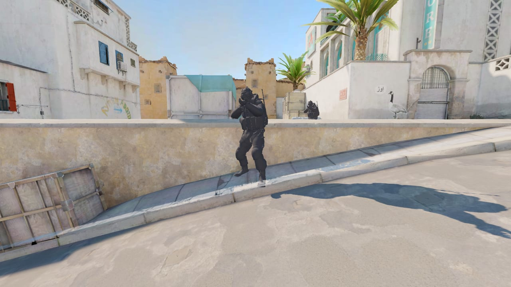
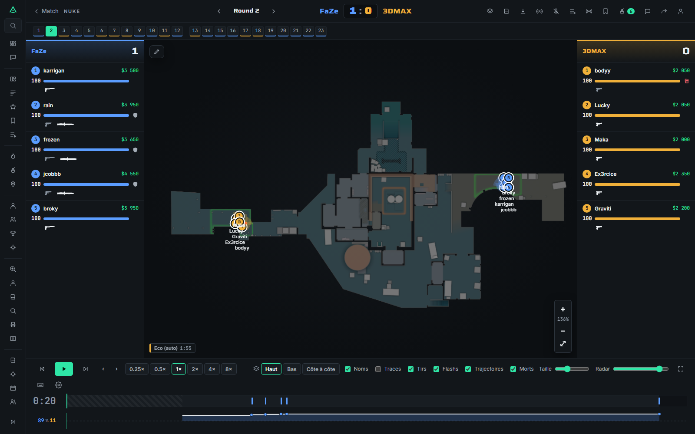
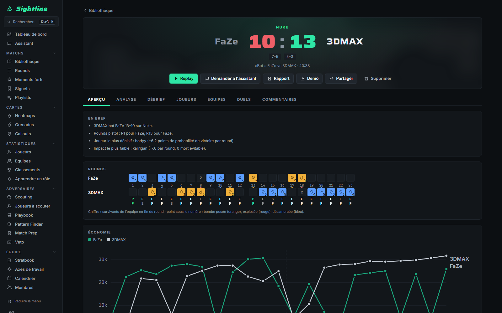
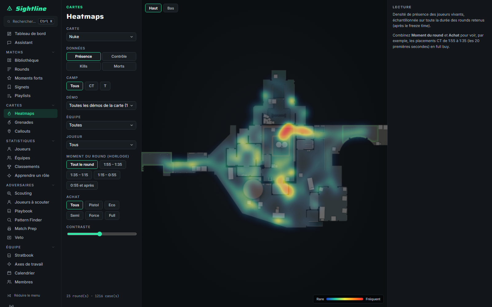
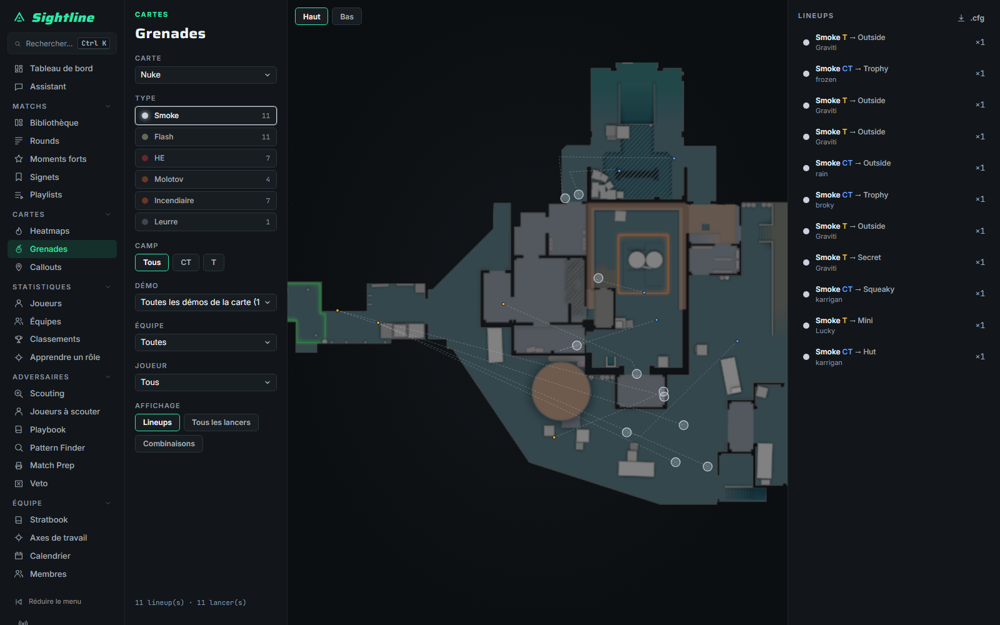
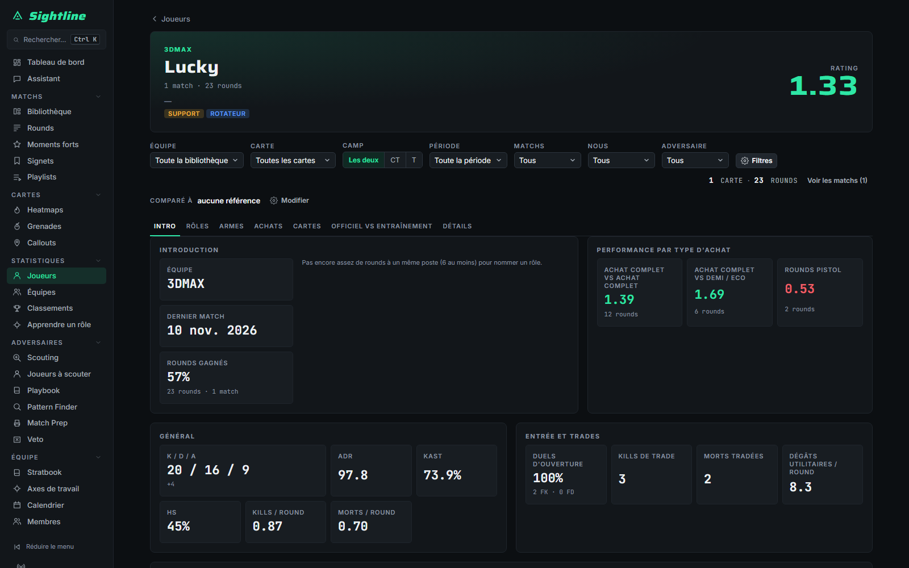

# Sightline — CS2 demo analysis platform

[](https://github.com/BoooJ/sightline/actions/workflows/ci.yml)

Sightline is a full-stack web platform that turns Counter-Strike 2 demo files into a 2D/3D replay,
team and player analytics, scouting reports and an AI assistant for a competitive team. It runs in production for my
team: self-hosted with Docker, behind HTTPS, with team accounts.

Built from scratch between **October 10 and November 10, 2026**, about **590 commits**.


<sub>3D replay renderer: Dust2 exported from the game, animated agent models, the game's own baked lighting and sun
shadows. The lighting is still in development and is not in this snapshot.</sub>

---

## What it does

| | |
|---|---|
| **Ingestion** | Chunked upload, watched folders, import by link (HLTV, FACEIT). Demos are parsed in a process pool with [demoparser2](https://github.com/LaihoE/demoparser) (Rust) into 32 Hz frames, stored as msgpack + zstd blobs in SQLite (Alembic migrations). |
| **2D replay** | Radar playback with grenade trajectories, flashes, kills, bomb, multi-round overlay, drawings and notes, synced team voice comms, custom shortcuts, GIF export, public share links. |
| **3D replay** (three.js) | Maps exported from the game (Source 2 Viewer CLI → glTF, meshopt, WebP), first-person view with arms and weapons, animated player models, five cameras, full in-game HUD. **Ragdoll deaths** (next release): a custom deterministic XPBD solver running in a Web Worker against the map's collision mesh, driven by the death impulse read from the demo. |
| **Analytics** | Match overview, economy, win probability, ratings (KAST, ADR, HS%, impact), opening duels, trades, utility damage, role detection, heatmaps (presence, control, kills, deaths with time/buy/side filters), grenade lineups with `.cfg` export, highlights, leaderboards, team stats. |
| **Team workflow** | Stratbook with drawings, playbook with automatic tactic detection, pattern finder, veto simulator, match prep reports, scouting (HLTV, FACEIT, ESEA), callouts editor, calendar, bookmarks and playlists, "learn a role/position" study mode. |
| **AI assistant** | Questions about matches, scouting reports and coaching notes, backed by Anthropic Claude or Google Gemini (key per team), grounded on the team's own data with links back to the rounds. |
| **Integrations** | n8n workflows (scrim scheduling, Discord notifications, FACEIT imports), a Chrome extension (Manifest V3), a **TeamSpeak 3 plugin in C++** that records team comms and syncs them to replays, and a mobile app (Expo / React Native, web push). |

<table>
  <tr>
    <td><br><sub>2D replay</sub></td>
    <td><br><sub>Match overview: rounds, economy</sub></td>
  </tr>
  <tr>
    <td><br><sub>Heatmaps with time, side and buy filters</sub></td>
    <td><br><sub>Grenade lineups and trajectories</sub></td>
  </tr>
  <tr>
    <td colspan="2"><br><sub>Player profile</sub></td>
  </tr>
</table>

<sub>Screenshots use a public pro match (FaZe vs 3DMAX on Nuke) from the test fixtures. The UI is in French: it is
built for a French-speaking team.</sub>

---

## Architecture

```
            ┌──────────────────────────── browser ─────────────────────────────┐
            │ React 18 + TypeScript (Vite) · TanStack Query · Zustand           │
            │ 2D replay (canvas) · 3D replay (three.js, Web Worker physics)     │
            └───────────────┬───────────────────────────────────────────────────┘
                            │ JSON / msgpack, SSE
┌───────────────────────────▼────────────────────────────────────────────────────┐
│ FastAPI (Python 3.12) · SQLAlchemy 2 · Alembic · SQLite                         │
│ ingest: process pool (spawn) → demoparser2 → frames (numpy/pandas/pyarrow)      │
│ stats · scouting (HLTV, FACEIT) · AI (Anthropic / Gemini) · team accounts       │
└───────────────┬───────────────────────────────┬─────────────────────────────────┘
                │                               │
     n8n workflows, Chrome extension,     3D export tooling (Node.js, run on a PC with CS2):
     TeamSpeak plugin (C++), mobile app   Source 2 Viewer CLI → gltf-transform → meshopt/WebP
```

Some technical choices worth a look:

- **Demo parsing under memory limits.** Parsing runs in a `spawn` process pool, one task per worker, reading the demo
  in passes so that 32 Hz parsing of a full match stays under a 3 GB container limit. A frame codec keeps old and new
  blobs readable both ways, so a deployment can be rolled back without re-parsing (`backend/app/storage/frames_codec.py`).
- **Ragdoll physics** (`frontend/src/features/replay3d/ragdoll*.ts`): extended position-based dynamics with hinge and
  twist limits, contacts against a uniform grid built from the game's collision mesh, sleeping, a deterministic
  replay (same tick → same pose, forward or backward), all computed in a Web Worker that never imports three.js.
- **3D asset pipeline** (`scripts/map3d`): drives the Source 2 Viewer CLI against the user's own CS2 install, reads
  Valve KeyValues3 and physics blocks, simplifies, quantizes and compresses meshes, and uploads per-map variants
  (gray, textured, collision). Game files never enter the repository; they are served to logged-in team members only.
- **Performance budget:** the 3D view targets 60 fps on an integrated Intel UHD GPU. Maps are merged into a handful
  of draw calls, textures are sized under a GPU memory budget, and caches survive switching between the 2D and 3D views.

## How it was built

I am the sole developer and product owner. Sightline was built with **Claude Code as an AI pair-programmer**, using a
disciplined workflow:

1. **Spec, then plan.** Each feature starts as a design spec, then a task-by-task implementation plan with exact files,
   interfaces and tests.
2. **Test-first.** Every task is written test-first. The test has to fail for the right reason before any code exists.
3. **Independent reviews.** Every batch of tasks gets a fresh reviewer that sees the diff, the spec and the plan, but
   not the implementer's conclusions. Findings come back as Critical, Important or Minor, and each fix starts with a
   failing test.
4. **Parallel work streams** in separate git worktrees, and a **staged production rollout** each time: database
   backup, counts before and after, health checks, and a written rollback procedure (database, config and image
   restored together).

The code, comments and commit messages are in French.

## Tests

| Suite | Tool | Size |
|---|---|---|
| Backend | pytest | 461 tests (66 files) |
| Frontend | vitest | 710 tests (54 files) |
| End-to-end | Playwright (Chromium, real WebGL 2) | 91 scenarios |
| 3D export tooling | node:test | 89 tests |
| TeamSpeak plugin | C++ unit tests | 53 cases |
| Mobile app | vitest | 18 files |

The backend, frontend and export suites run on every push (see the CI badge). End-to-end tests need a seeded database
and a GPU-enabled browser, so they run locally (`cd frontend && npx playwright test`).

## Run it locally

Requirements: Python 3.12+, Node.js 20+ (24 recommended).

```bash
./start.sh          # Linux / macOS
./start.ps1         # Windows (first run installs everything; -Prod serves the built frontend)
```

Then open the app and add a folder of `.dem` files, or drop demos on the window. Copy `config.example.toml` to
`config.toml` to change settings (sample rate, modules, AI keys).

Production uses the multi-stage `Dockerfile` and `deploy/compose.yaml` (non-root user, all capabilities dropped,
memory limit, health check, nightly SQLite backups with `deploy/backup.sh`).

## Repository layout

| Path | Contents |
|---|---|
| `backend/` | FastAPI app (`app/`), Alembic migrations, pytest suite and fixtures |
| `frontend/` | React app (`src/features/*`, one folder per feature), Playwright end-to-end tests |
| `scripts/map3d/` | 3D export tooling (maps, player models, animations, ragdoll, collision) |
| `mobile/` | Expo / React Native app |
| `plugin/` | TeamSpeak 3 plugin (C++, CMake) |
| `extension/` | Chrome extension (Manifest V3) |
| `deploy/` | Docker Compose, backup script, n8n workflows |
| `maps/` | Radar overviews and map metadata for the 2D replay |

## Status and roadmap

In production for my team. In development on separate branches, not in this snapshot:

- **Game-accurate world rendering:** the game's baked lightmaps and sun shadows, sky, volumetric smokes ray-marched
  against the collision mesh (with holes from bullets and HE grenades), and molotov fire spreading on the ground.
- **Materials as in the game:** two-layer blended materials, masked tints, vertex tint.
- **Game lighting on players:** players and props lit from the game's light probes, the game's tone curve, and player
  shadows on the ground.
- **Player gestures from outside:** shooting, reloading and throwing animations seen by other players.

This repository is a curated snapshot of the main development repository (which is private). Deployment details and
internal planning documents are left out.

---

© 2026 Paul Morel. All rights reserved: the code is shared for review, not under an open-source license.
Not affiliated with Valve. Counter-Strike 2 and its assets are the property of Valve Corporation. Game files are never
stored in this repository; the export tooling extracts them from a local CS2 installation.
